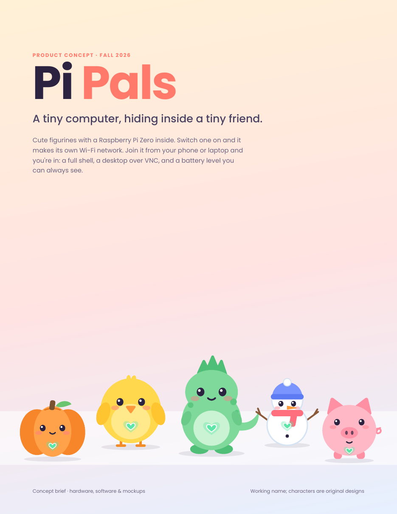
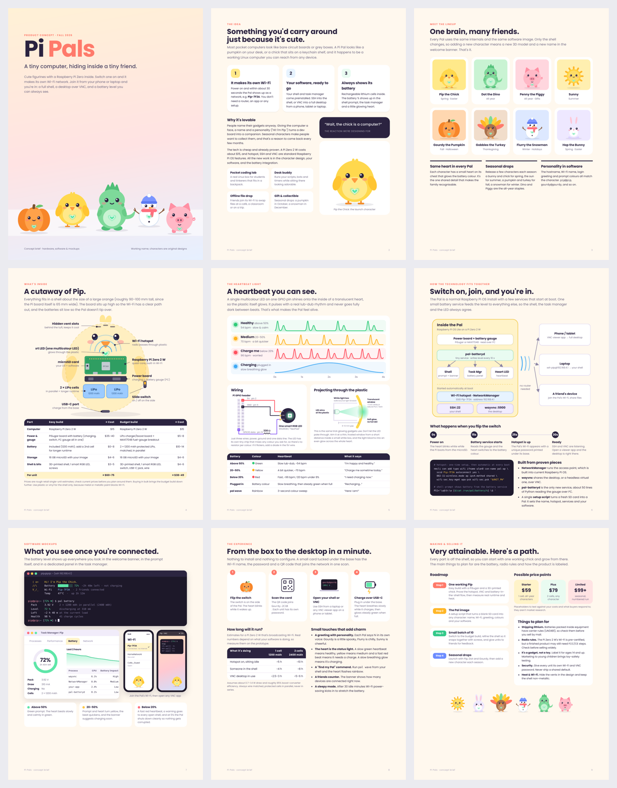
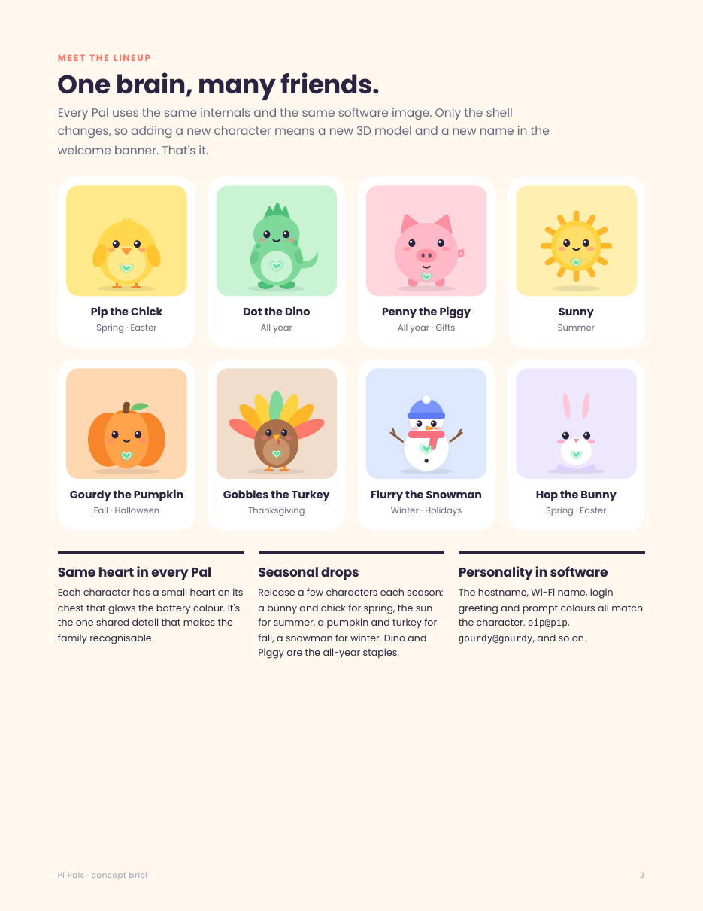
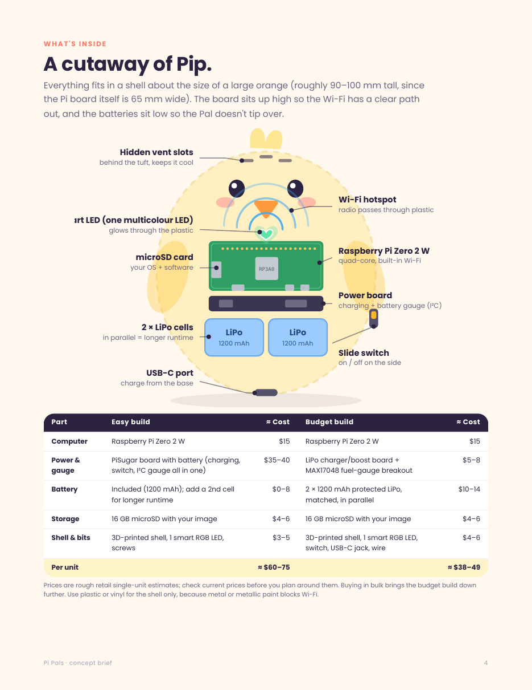
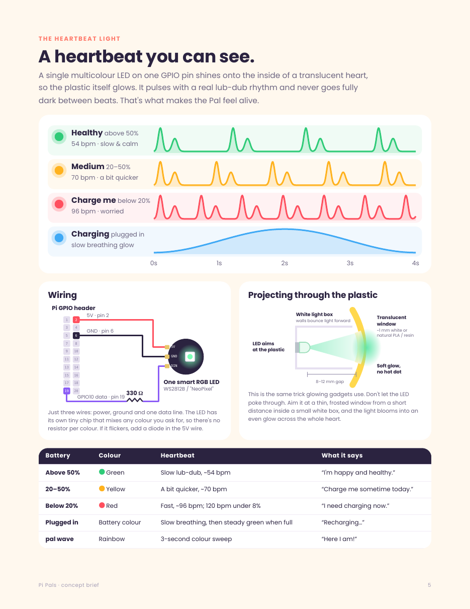
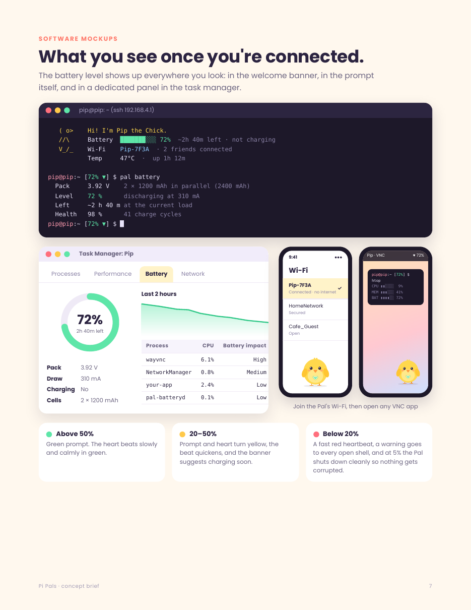

# 🐣 Pi Pals

**Cute little figurines with a whole Raspberry Pi computer hiding inside.**

Pi Pals are seasonal characters — a chick, a dino, a piggy, a pumpkin, a snowman and more — each with a Raspberry Pi Zero 2 W tucked inside. Turn one on and it makes its own Wi‑Fi network, so you can connect from a phone or laptop and use its desktop over VNC. No router needed. A glowing heart on its chest beats to show how much battery is left.

Every Pal comes with **[The Shelf](https://github.com/hardwaremack-prog/the-shelf)** and the **[Tidy Suite](https://github.com/hardwaremack-prog/tidy-suite)** already installed. Join the Pal's Wi‑Fi, open a browser, and you have a pocket home hub with photos, music, notes, files and messaging, plus a full set of everyday apps: spreadsheets, documents, slides, bills, meals and more. There's no account to make, no internet needed, and no cloud.

They're something you'd actually want to carry around: a pocket coding lab, a desk buddy, an offline file-sharing hub, or a gift.

✨ **New: [Pi Pals Pro](#-pi-pals-pro-a-pal-you-can-talk-to)** is a bigger Raspberry Pi 5 Pal you can **talk to**. Its AI runs entirely inside it, and the README includes model speeds in tokens per second.

> **Status:** concept / design stage. "Pi Pals" is a working name.

<p align="center">
  <a href="docs/Pi-Pals-Concept.pdf"></a>
</p>

📄 **[Read the full concept brief (PDF, 9 pages)](docs/Pi-Pals-Concept.pdf)**

---

## Meet the Pals

| Pal | Season |
|---|---|
| 🐥 **Pip the Chick** | Spring |
| 🦕 **Dot the Dino** | Any time |
| 🐷 **Penny the Piggy** | Any time |
| ☀️ **Sunny** | Summer |
| 🎃 **Gourdy the Pumpkin** | Fall |
| 🦃 **Gobbles the Turkey** | Thanksgiving |
| ⛄ **Flurry the Snowman** | Winter |
| 🐰 **Hop the Bunny** | Easter |

All original characters — no licensed ones.

## What's inside

Everything fits in a shell about the size of a **large orange** (roughly 90–100 mm tall — the Pi board alone is 65 mm wide).

- **Raspberry Pi Zero 2 W** — the brain (snappier over VNC than the original Zero W)
- **Battery board** — a PiSugar for the easy build, or a LiPo + charger/boost board + **MAX17048** fuel gauge for the budget build. Either reports battery % to the software.
- **Lithium cells** — one, or two matched protected cells **in parallel** for longer runtime (a few hours per ~1200 mAh with Wi‑Fi broadcasting)
- **One smart RGB LED** (WS2812B / "NeoPixel") behind a translucent heart
- **Power switch + USB‑C charging port** hidden under the base
- **Hidden vents** — the Zero 2 W gets warm in a sealed shell
- **Plastic or vinyl shell** — metallic paint or metal blocks Wi‑Fi

### Rough cost per unit

| Build | Cost |
|---|---|
| Easy build (PiSugar) | ~$60–75 |
| Budget build (LiPo + fuel gauge) | ~$38–49 |

## Comes with The Shelf and Tidy Suite

Every Pal ships with both of these preinstalled and starts them at boot.

### 📚 [The Shelf](https://github.com/hardwaremack-prog/the-shelf)
A little self-hosted hub. Anyone who joins the Pal's Wi‑Fi can open it in a browser to:
- look at pictures (with a slideshow), play music and watch videos
- download games and programs you've put on the Pal
- use the built-in notes, drawing pad, word processor, spreadsheet and quick slides
- message other people on the same network
- pin things to a home dashboard with a bulletin board and quick links

### 🧹 [Tidy Suite](https://github.com/hardwaremack-prog/tidy-suite)
A whole set of everyday apps, opened from The Shelf, with a "Saved" light in each so you know your work is safe:

| App | What it's for |
|---|---|
| **Tidy** | Spreadsheets |
| **Neat** | Word processing (with printing) |
| **Spruce** | Slides and presentations (with printing) |
| **Steady** | Bills: a hopeful plan, a progress dashboard and CSV/Excel import |
| **Clearout** | Selling things: prices, listings, where to sell, a sales dashboard |
| **Handy** | Earning with your time by offering local services |
| **Hearty** | Meals, shopping lists and food on a budget |
| **Ready** | Calendar and to-dos |
| **Stocked** | Home inventory |
| **Polished** | Resume and job hunt |
| **Chipper** | Kids' chores and allowance |
| **Sorted** | Repair projects: cars, mowers, HVAC and more |
| **Rugged** | Grid-down and survival guide |
| **Snug** | Backup and restore for the whole suite |

Each person picks their name from a dropdown, so everyone's saves stay separate, even with several phones connected to one Pal.

> **Pi Zero 2 W note:** the Zero 2 W has only 512 MB of RAM. The Shelf and the Tidy Suite apps are light, but The Shelf's local AI chat tab needs more memory than a regular Pal has. For AI, see [Pi Pals Pro](#-pi-pals-pro-a-pal-you-can-talk-to).

## ✨ Pi Pals Pro: a Pal you can talk to

A bigger Pal built on a **Raspberry Pi 5 (4 GB)**. Hold its heart, ask it something, let go, and it answers out loud in its own character's voice. Everything runs inside the Pal, with no internet, no account and no cloud. It still comes with The Shelf and Tidy Suite, and The Shelf's AI chat tab works on it too.

### Is a Pi 5 fast enough?

**Yes, for a friendly chat with a small AI model. No, for ChatGPT-level smarts.**

- People talk at about 3–4 tokens a second, so any model that writes faster than about 5 tokens a second keeps up with speech.
- On a Pi 5, the 1–1.5 billion-parameter models write **7–15 tokens a second**, comfortably faster than talking.
- With the default model, you hear the first words about **2–4 seconds** after you let go of the button.
- These small models are great for chatting, simple questions, jokes, stories and homework-style help. They aren't great at hard facts or long reasoning, and they can be confidently wrong, so the Pal is told to say when it isn't sure.

### AI models that fit a 4 GB Pal

The speeds below are for a Pi 5 running llama.cpp on its CPU (4 threads) with 4-bit (Q4_K_M) models. They're **typical ranges from published Pi 5 tests, not measured on a Pal yet**. Run `pal-bench` on your own Pal to get its real numbers (see below).

| Model | Download | Reply speed (tokens/sec) | Keeps up with talking? | What it's like |
|---|---|---|---|---|
| Qwen2.5 0.5B (`fast`) | 0.4 GB | ~20–30 | ✅ easily | Instant, but simple and more often wrong |
| Llama 3.2 1B | 0.8 GB | ~10–15 | ✅ easily | Quick and chatty |
| Gemma 3 1B | 0.8 GB | ~10–14 | ✅ easily | Quick and friendly |
| **Qwen2.5 1.5B** (default) ⭐ | 1.1 GB | ~7–10 | ✅ yes | **Best mix of speed and sense** |
| Llama 3.2 3B (`smart`) / Qwen2.5 3B | 2.0 GB | ~3.5–5 | ⚠️ just about | Noticeably smarter, with noticeable pauses |
| Phi-3.5 mini 3.8B | 2.4 GB | ~2.5–4 | ❌ lags | Too tight for 4 GB alongside The Shelf |
| 7–8B models | 4.5 GB+ | — | ❌ | Won't fit in 4 GB (an 8 GB Pi 5 manages ~1.5–2.5) |

**Hearing and speaking**

| Part | Tool | Speed on a Pi 5 (typical) |
|---|---|---|
| Hearing you | whisper.cpp, `base.en` model | About 1–2 s to understand a short sentence (`tiny.en` is about twice as fast but makes more mistakes) |
| Talking back | Piper, `amy-low` voice | Faster than real time. It starts speaking each sentence as soon as the AI finishes writing it |

### What about the AI HAT+ 2?

Raspberry Pi's **AI HAT+ 2** (Hailo-10H chip, 40 TOPS, its own 8 GB of memory, about $130) can run AI models on the HAT itself. In early reviews it ran small chat models at **about the same speed as the Pi 5's own CPU, or slower**, and only with Hailo's own list of models. It's much better at camera and vision work, and it leaves the CPU free. For a talking Pal it adds cost, size and heat without making replies faster, so **Pro v1 skips it**. It's worth another look if a later Pal gets a camera, for example one that recognizes your face.

### What's inside a Pro Pal

The shell is bigger, about the size of a **small cantaloupe** (roughly 130–150 mm). The Pi 5 board is 85 × 56 mm and needs a fan.

| Part | Why | Rough cost |
|---|---|---|
| Raspberry Pi 5, 4 GB | The brain | ~$60 |
| Active Cooler | AI keeps all four cores busy; without a fan it slows down from heat | ~$5 |
| 5 V / 5 A battery board (UPS HAT) with 18650 or 21700 cells | The Pi 5 needs up to 5 A; ordinary Pi Zero battery boards can't supply it | ~$50–75 |
| Small USB mic | Hearing | ~$5–10 |
| 3 W speaker + MAX98357A amp | Talking | ~$8 |
| Push-to-talk button behind the heart | Hold to talk | ~$1 |
| microSD 32 GB+ (or an NVMe drive) | Room for models | ~$10 |
| Shell, heart LED, switch, USB-C port | Same as a regular Pal | ~$10 |
| **Total** | | **~$150–180** |

**Battery life (estimate):** about 3 W sitting idle and 8–10 W while it's thinking. A pack of four 18650 cells (about 40 Wh) gives roughly **4 hours of non-stop chatting**, or most of a day of normal use. Prices are rough and move around; Pi 5 prices went up in late 2025 when memory got more expensive.

### The heart shows what it's doing

| Heart | Meaning |
|---|---|
| 💙 Steady blue | Listening |
| 💜 Quick purple swirl | Thinking |
| 🩵 Cyan flicker | Talking |
| 💚💛❤️ Heartbeat | Battery, the same as a regular Pal |

Each character has its own personality. Pip is cheerful and curious, Dot loves nature facts, Gourdy is a tiny bit spooky, and so on. Set yours in `/etc/pal/voice.env`.

### Set it up

On 64-bit Raspberry Pi OS Lite on a Pi 5 (4 GB):

```bash
cd pi-pals/software/pro
sudo ./install-pro.sh                  # default brain: Qwen2.5 1.5B
sudo PAL_MODEL=fast ./install-pro.sh   # or the quickest: Qwen2.5 0.5B
sudo PAL_MODEL=smart ./install-pro.sh  # or the smartest that fits: Llama 3.2 3B
```

This builds llama.cpp and whisper.cpp (about 20 minutes on a Pi 5), installs Piper, downloads the models and starts two services. After that:

```bash
pal-voice --keyboard     # talk using Enter instead of the button (handy over SSH)
pal-voice --text         # type to it; it still talks back
pal-bench                # measure every model's speed on THIS Pal -> bench-results.md
```

## Software

```
  Phone / laptop ──Wi‑Fi──► Pal's own hotspot (NetworkManager)
                                   │
                                   ├──► The Shelf + Tidy Suite (open in any browser)
                                   ├──► VNC desktop (wayvnc, headless)
                                   ├──► My shell + task manager (shows battery %)
                                   └──► Heartbeat LED service
```

- **Hotspot:** NetworkManager starts a Wi‑Fi access point at boot with one `nmcli` command.
- **VNC:** wayvnc with a virtual display, so it works with no screen attached.
- **The Shelf + Tidy Suite** start at boot. Phones and laptops on the Pal's Wi‑Fi just open it in a browser.
- **My shell & task manager** come preinstalled and show the battery level in the prompt, the login banner and the task manager.

## The heartbeat light

One multicolour LED glows through a translucent heart and pulses like a heartbeat:

| Battery | Colour | Beat |
|---|---|---|
| Healthy | 🟢 Green | Slow |
| Getting low | 🟡 Yellow | Medium |
| Low | 🔴 Red | Fast |

Plus a rainbow "wave" effect for fun.

**Wiring (3 wires):** 5V → pin 2 · Ground → pin 6 · Data → pin 19 through one small resistor. Needs SPI turned on in `raspi-config`. The LED is rated for 5V and the Pi's data line is 3.3V — most work fine, but if it flickers, add a cheap diode on the 5V wire.

## Unboxing

Flip the switch → the heart glows → join the Pal's Wi‑Fi → open a browser for The Shelf and Tidy Suite, or VNC for the full desktop.

## Concept brief

The [concept PDF](docs/Pi-Pals-Concept.pdf) covers the idea, character lineup, hardware cutaway and costs, the heartbeat light, how the software fits together, shell and task-manager mockups, the unboxing flow, and a roadmap with price ideas.



| Meet the lineup | A cutaway of Pip |
|---|---|
|  |  |
| **The heartbeat light** | **What you see once connected** |
|  |  |

## Software in this repo

| File | What it does |
|---|---|
| [`software/pal-heartbeat.py`](software/pal-heartbeat.py) | Drives the heartbeat LED from the battery level. Smart LED by default; `--led rgb` for the older four-leg kind; `--demo` to cycle through the beats. |
| [`software/pal-heartbeat.service`](software/pal-heartbeat.service) | systemd service so the heartbeat starts at boot. Install notes are at the top of the file. |
| [`software/pro/pal-voice.py`](software/pro/pal-voice.py) | **Pro:** push-to-talk loop. Whisper hears you, the local AI answers in character, Piper speaks it sentence by sentence, and the heart shows listening, thinking or talking. |
| [`software/pro/pal-bench.sh`](software/pro/pal-bench.sh) | **Pro:** downloads each model that fits and measures prompt and reply tokens/sec on your Pal, writing a table to `bench-results.md` |
| [`software/pro/install-pro.sh`](software/pro/install-pro.sh) | **Pro:** builds llama.cpp and whisper.cpp, installs Piper and the models, and starts `pal-llm` and `pal-voice` |

## Things to sort out before selling

- **Lithium battery shipping rules**
- **Radio certification** for a device with Wi‑Fi
- **Age labeling** — clearly marked *not for small kids*, since it has a lithium battery
- Generic characters only, no licensed ones

---

*Part of the things I'm making :) — see also [PiMesh](https://github.com/hardwaremack-prog/PiMesh), [rpi-task-manager](https://github.com/hardwaremack-prog/rpi-task-manager) and [Pedal Power Station](https://github.com/hardwaremack-prog/pedal-power-station).*
